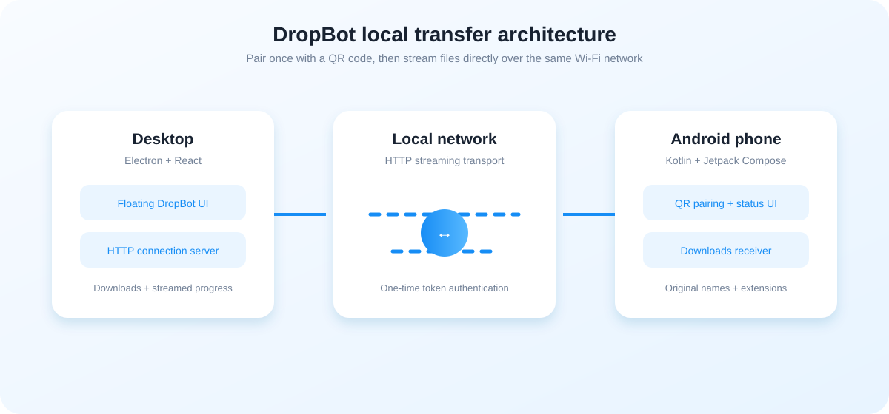
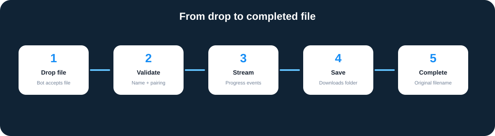

# DropBot



**DropBot is a friendly local-network file transfer companion for Windows and Android.** Pair a phone by scanning one QR code, then drag a file onto the floating desktop bot. DropBot streams the file directly over Wi-Fi and preserves the original filename and extension.

> Status: working prototype / actively evolving  
> Supported transfer direction: desktop ↔ Android phone  
> Transport: local HTTP streaming with one-time pairing tokens

## Highlights

- QR-based pairing without accounts, cloud storage, or file uploads to a third party.
- Floating, movable Electron bot with a dedicated drag handle.
- Desktop drag-and-drop file transfer.
- Real streaming progress for large files.
- Android files are saved to the public **Downloads** folder.
- Original names and extensions are preserved, including spaces and Unicode.
- Existing files are never overwritten: `photo.png`, `photo (1).png`, etc.
- Temporary/pending writes prevent incomplete files from appearing as completed.
- Token-authenticated transfers in both directions.
- Android Compose onboarding, pairing, home, history, devices, and settings screens.
- Same-Wi-Fi operation with useful pairing and startup error feedback.



## Architecture

```text
Windows desktop
  React renderer
    └─ DropBot UI, QR display, state and progress
  Electron preload
    └─ context-isolated IPC bridge
  Electron main process
    └─ window movement, pairing server, streamed desktop → phone upload
         │
         └── local Wi-Fi / HTTP + one-time token
                │
Android phone
  Kotlin + Jetpack Compose
    └─ onboarding, QR scanner, transfer controls, navigation
  NetworkManager
    └─ pairing request, phone upload server, Downloads receiver
```

### Desktop modules

| Module | Responsibility |
| --- | --- |
| `src/main/main.ts` | Creates the frameless window, handles IPC, and controls movement. |
| `src/main/connectionServer.ts` | Starts the LAN HTTP server, creates QR payloads, pairs devices, and streams files. |
| `src/preload/preload.ts` | Exposes a small safe API to the renderer through `contextBridge`. |
| `src/renderer/components/Bot/DropBot.tsx` | Handles drag/drop, visual states, movement handle, and transfer lifecycle. |
| `src/renderer/store/botStore.ts` | Stores connection and transfer progress state. |

### Android modules

| Module | Responsibility |
| --- | --- |
| `MainActivity.kt` | Compose onboarding, scanner, home navigation, and file picker. |
| `NetworkManager.kt` | Finds the phone LAN address, pairs with the desktop, uploads phone files, and receives desktop files. |
| `AndroidManifest.xml` | Declares network, camera, and legacy storage capabilities. |

## Requirements

### Desktop

- Windows 10 or newer
- Node.js 22 or newer
- npm
- Both devices connected to the same Wi-Fi/LAN
- Windows Firewall permission for the DropBot local server

### Android

- Android SDK and Android Studio
- JDK compatible with the configured Android Gradle Plugin
- Android 7.0 / API 24 or newer
- Camera permission for QR scanning

## Quick start

### 1. Clone and install desktop dependencies

```powershell
git clone <your-repository-url>
cd DropBot
npm install
```

### 2. Run the desktop development app

Open two terminals:

```powershell
# Terminal 1: Vite renderer
npm run dev
```

```powershell
# Terminal 2: Electron main process
npm run electron
```

The application loads the renderer at `http://localhost:5173`. Keep the Vite process running while Electron is open.

### 3. Build the desktop renderer

```powershell
npm run typecheck
npm run build
```

Production renderer output is written to `dist/renderer/`.

### 4. Build the Android application

From the Android project directory:

```powershell
cd android/DropBot
.\gradlew.bat :app:assembleDebug
```

The debug APK is written to:

```text
android/DropBot/app/build/outputs/apk/debug/app-debug.apk
```

Install it on a connected device:

```powershell
adb install -r app/build/outputs/apk/debug/app-debug.apk
```

## Pairing guide

1. Start DropBot on Windows.
2. Open the DropBot panel by clicking the bot face.
3. Confirm the QR code is visible.
4. Open the Android app.
5. Complete the phone-name step.
6. Tap **Scan QR Code** and allow camera access.
7. Scan the desktop QR code.
8. Wait for **Connected** on both devices.

The QR payload contains the selected desktop LAN address, active HTTP port, protocol version, and a random one-time token. The token is used for pairing and transfer authentication.

## Desktop → Android transfer

1. Confirm the phone is connected.
2. Drag a file from Windows File Explorer.
3. Drop it onto the bot body.
4. The bot shows accepted/transferring/completed states.
5. The phone writes the file to its public **Downloads** folder.

Example:

```text
Laptop: C:\Users\You\Pictures\yash.png
Phone:  Downloads/yash.png
```

The receiver preserves the display name and extension. Duplicate names are automatically suffixed rather than overwritten.

## Android → desktop transfer

1. Open the Android app home screen.
2. Tap **Send Files**.
3. Select a file using the Android document picker.
4. The original display name is sent in the transfer header.
5. The desktop saves it to the Windows Downloads directory.

## Transfer protocol

The desktop server listens on port `8765` when available and selects a random port if the preferred port is busy. The Android receiver listens on port `8766`.

### Pairing

```http
POST /pair
Content-Type: application/json

{
  "token": "<one-time-token>",
  "name": "Yash's Phone",
  "host": "192.168.1.25",
  "port": 8766
}
```

### File upload

```http
POST /upload
X-DropBot-Filename: yash.png
X-DropBot-Token: <one-time-token>
Content-Length: <bytes>
```

Uploads are streamed directly to disk. The Android receiver uses `MediaStore.Downloads` on Android 10+ and publishes the file only after the complete body has been received.

## Security and privacy

- Files are transferred directly between paired devices on the local network.
- No cloud relay or account is required.
- Pairing tokens are random and regenerated when the desktop server starts.
- Upload endpoints require the pairing token.
- Filenames are reduced to safe leaf names; path traversal is prevented.
- Desktop uploads use temporary `.part` files before final rename.
- Android 10+ uses pending MediaStore entries until the transfer completes.

This is local-network security, not end-to-end encryption. Do not pair on an untrusted network.

## Development commands

| Command | Purpose |
| --- | --- |
| `npm install` | Install desktop dependencies. |
| `npm run dev` | Start the Vite renderer development server. |
| `npm run electron` | Start the Electron desktop app. |
| `npm run typecheck` | Run TypeScript checks without emitting files. |
| `npm run build` | Create a production renderer build. |
| `npm run preview` | Preview the built renderer with Vite. |
| `.\gradlew.bat :app:assembleDebug` | Build the Android debug APK. |
| `.\gradlew.bat :app:testDebugUnitTest` | Run Android unit tests. |

## Troubleshooting

### QR scan succeeds but the desktop stays disconnected

- Confirm both devices are on the same Wi-Fi network.
- Disable VPNs temporarily.
- Allow Node/Electron through Windows Firewall on private networks.
- Restart the desktop app to generate a fresh token and QR code.
- Check that the phone is not using a guest Wi-Fi network with client isolation.

### The bot does not move

Use the visible rounded handle above the bot. The bot body is intentionally reserved for file dropping.

### A dropped file does not start

- Restart Electron after rebuilding so the preload bridge reloads.
- Drop directly onto the bot body, not the movement handle.
- Confirm the phone status says **Connected**.
- Check the visible transfer error state and Windows Firewall.

### The file is not visible on Android

- Open the system **Downloads** app or Files app.
- Confirm the transfer reached 100%.
- Reinstall the latest debug APK if an older build is still installed.
- Duplicate names are saved with a numeric suffix.

### Port conflicts

- Desktop prefers `8765` and automatically selects a free port if occupied.
- Android uses `8766`.
- The QR code always contains the current desktop port.

## Repository layout

```text
.
├── android/DropBot/          # Android Studio / Gradle project
├── docs/images/              # README architecture illustrations
├── public/                   # Static renderer assets
├── src/main/                 # Electron main process and LAN server
├── src/preload/              # Context-isolated IPC bridge
├── src/renderer/             # React UI, animations, store, styles
├── package.json              # Desktop scripts and dependencies
├── tsconfig.json             # TypeScript configuration
├── vite.config.ts            # Renderer build configuration
└── README.md                 # Project documentation
```

## Contributing

1. Create a focused branch.
2. Keep desktop and Android protocol changes synchronized.
3. Run `npm run typecheck` and `npm run build`.
4. Run the Android debug build and relevant tests.
5. Test both transfer directions with a small file and a large file.
6. Confirm original filenames, duplicate handling, and interrupted-transfer behavior.

## License

Add the project license that matches your intended distribution before publishing the repository.
